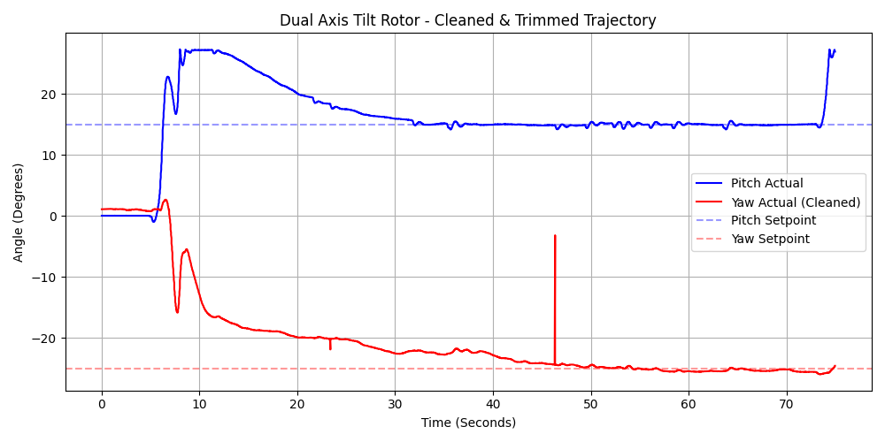

# Dual-Axis Tilt Rotor Balancing

**Control:** Independent PID feedback loops · **Platform:** Arduino Mega 2560 · **Feedback:** Two AMT22 absolute encoders over SPI · **Actuation:** DC motors/propellers through L298N

## Objective

Control pitch and yaw simultaneously, commanding the system from \((0^\circ,0^\circ)\) to \((15^\circ,-25^\circ)\). The principal specification was peak overshoot \(\leq5\%\) on both axes while minimizing peak time.

## Hardware and interfacing

- Arduino Mega 2560 (ATmega2560)
- Dual-axis tilt-rotor setup with two DC motor/propeller assemblies
- L298N motor driver and 24 V supply
- Two AMT22 absolute encoders
- Custom tuning PCB with three potentiometers

The AMT22 encoders use hardware SPI. The implementation masks the 14-bit position field using `0x3FFF`, then maps the result to a signed angular range. The Arduino generates 8-bit Fast PWM commands (0–255). A software dead zone compensates for static friction.

## Control implementation

Two independent PID loops regulate pitch and yaw. Proportional action responds to position error, derivative action provides damping against physical momentum, and integral action compensates persistent load torque (particularly gravity on pitch).

Implementation details recorded in the report:

- Fixed 50 Hz loop (\(dt=0.02\) s), scheduled using `millis()`.
- Three potentiometers map ADC readings (0–1023) to live \(K_p,K_i,K_d\) tuning values.
- Integral anti-windup limits constrain accumulated error.
- Invalid encoder packets (`0xFFFF`) are rejected by retaining the last valid angle.
- Separate pitch and yaw motor-driving constraints were introduced to reduce cross-axis disturbance while the other axis settled.

## Tuned gains and results

| Metric             | Pitch, target \(15^\circ\) | Yaw, target \(-25^\circ\) |
| ------------------ | -------------------------: | ------------------------: |
| \(K_p\)            |                      15.06 |                      4.85 |
| \(K_i\)            |                       1.78 |                      1.00 |
| \(K_d\)            |                      12.43 |                     16.93 |
| Peak overshoot     |                      3.33% |                      0.3% |
| Peak time          |                        8 s |                      73 s |
| Settling time      |                       35 s |                      75 s |
| Steady-state error |                \(0^\circ\) |               \(1^\circ\) |

The measured initial system delay was 47 ms. Both axes met the \(\leq5\%\) overshoot requirement. The measured peak times exceeded the design benchmarks (3.5 s for pitch and 2.5 s for yaw). The report characterizes the response as heavily damped: low overshoot and stability were prioritized over response speed.

### Measured pitch and yaw trajectory

## Files

- [`code/exp2_final.ino`](code/exp2_final.ino) — Arduino implementation
- [`data/rotor_angles.csv`](data/rotor_angles.csv) — recorded rotor-angle data
- [`data/raw_data.txt`](data/raw_data.txt) — raw telemetry
- [`results/cleaned_plot.png`](results/cleaned_plot.png) — cleaned trajectory

## Takeaway

The experiment demonstrates the interaction between two feedback-controlled axes on a nonlinear physical system. Derivative damping and axis-specific motor constraints improved stability, while integral action compensated persistent gravitational torque. The measured response illustrates the trade-off between overshoot and speed.
