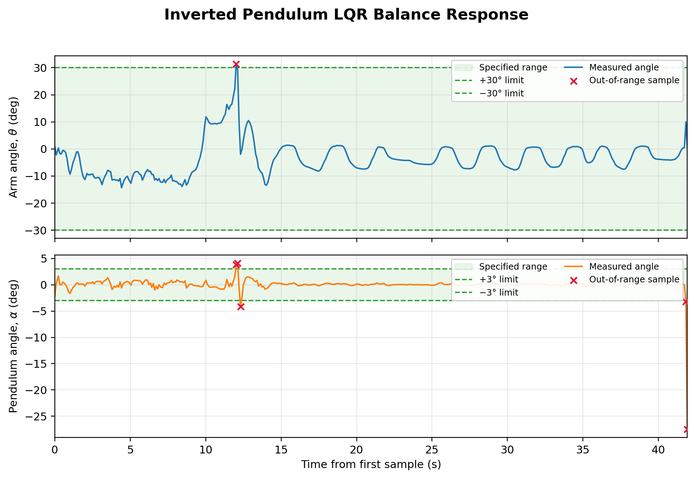
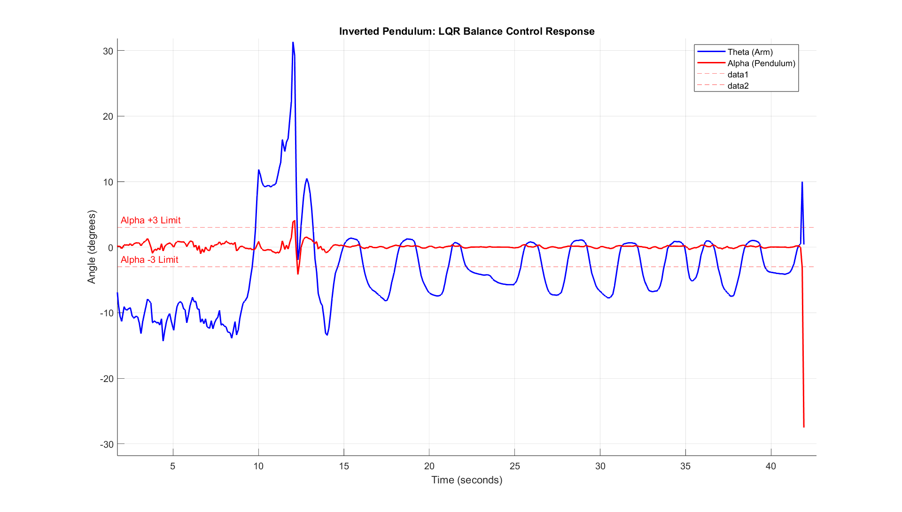

# Rotary Inverted Pendulum — LQR Balance and Energy-Based Swing-Up

**Control:** LQR and energy-based swing-up · **Platform:** Arduino Mega 2560 · **Feedback:** AMT22 absolute encoders over SPI

## Objective

Implement an LQR balance controller and energy-based swing-up controller. The combined controller starts with the pendulum hanging down, swings it toward upright, transfers control to LQR near upright, and returns to swing-up if balance is lost.

The stated objectives are $|\alpha|\leq 3^\circ$ for the pendulum and $|\theta|\leq 30^\circ$ for the arm. Here, $\alpha=0$ denotes upright.

## State-space model and LQR

The state vector is

$$
x=\begin{bmatrix}
\theta & \alpha & \dot{\theta} & \dot{\alpha}
\end{bmatrix}^{T},
\qquad
\dot{x}=Ax+Bu.
$$

The LQR control law is

$$
u=-Kx.
$$

The MATLAB design script uses

The MATLAB design script uses

$$
Q=\mathrm{diag}(100,400,10,1),
\qquad R=1.
$$

The gain vector hard-coded in the supplied Arduino sketch is

$$
K=\begin{bmatrix}
-10 & 155.667961 & -5.985342 & 20.612036
\end{bmatrix}.
$$

Encoder readings provide angular positions. Angular velocities are estimated using finite differences followed by low-pass filtering.

## Balance-only implementation

| Parameter | Reported value |
|:---|---:|
| Loop period / frequency | 5 ms / 200 Hz |
| Motor command limit | $\pm 12$ V |
| Motor deadband compensation | 2 V |
| Velocity low-pass filter coefficient | 0.35 |
| LQR engagement threshold | $|\alpha|<3^\circ$ |
| Firmware disengagement | $|\alpha|>30^\circ$ or $|\theta|>120^\circ$ |

The balance-only sketch starts after the pendulum has been manually brought close to upright.

## Automatic swing-up and balance

The combined sketch has idle, swing-up, and balance modes. The report gives the normalized pendulum energy as

$$
E=\frac{1}{2}\left(\frac{\dot{\alpha}}{\omega_0}\right)^2
+\cos(\alpha)-1,
\qquad
\omega_0=\frac{2\pi}{0.10\ \mathrm{s}}.
$$

The swing-up command is

$$
u_{\mathrm{sw}}=
\operatorname{clip}_{[-12,12]}
\left[
7(-E)\operatorname{sgn}(\dot{\alpha}\cos\alpha)
\right]\ \mathrm{V}.
$$

| Combined-controller parameter | Value |
|:---|---:|
| Loop period / frequency | 4 ms / 250 Hz |
| Swing-up energy period parameter | 0.10 s |
| Swing-up gain | 7.0 |
| Motor command saturation | $\pm 12$ V |
| Swing-up to LQR capture | $|\alpha|<5^\circ$ |
| LQR return to swing-up | $|\alpha|>30^\circ$ |

On capture, the implementation resets the arm-angle reference to zero while retaining measured angular velocities so LQR can brake residual motion. If the pendulum falls beyond the balance threshold, control switches back to swing-up.

## Experimental results

The recorded balance telemetry contains 420 samples over 41.918 s, with an approximately 100 ms logging interval.

| Measured quantity | Minimum | Maximum |
|:---|---:|---:|
| Arm angle, $\theta$ | $-14.33^\circ$ | $+31.33^\circ$ |
| Pendulum angle, $\alpha$ | $-3.49^\circ$ | $+4.09^\circ$ |

The report attributes brief excursions beyond the specified limits to an external disturbance applied during settling-time evaluation. The recorded extrema nevertheless exceed the nominal $\pm 30^\circ$ arm and $\pm 3^\circ$ pendulum limits; these measurements are reported here rather than claiming every sample stayed within limits.

### Measured arm and pendulum response from the report

### Supplied balance-response plot

## Files

- [`code/Balance.ino.ino`](code/Balance.ino.ino) — balance-only Arduino sketch
- [`code/swingUp.ino`](code/swingUp.ino) — combined swing-up and balance sketch
- [`matlab/matlab.m`](matlab/matlab.m) — MATLAB design script
- [`matlab/plotting.m`](matlab/plotting.m) — plotting script
- [`data/pendulum_data.csv`](data/pendulum_data.csv) — recorded telemetry
- [`results/balance.png`](results/balance.png) — response plot

## Takeaway

The experiment combines state-space feedback with a nonlinear swing-up strategy. It demonstrates switching between control modes, encoder-based state estimation, filtered velocity feedback, voltage saturation, and the practical difference between controller design limits and measured disturbance response.
