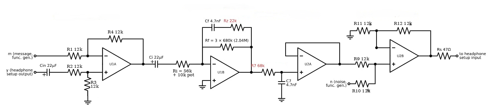
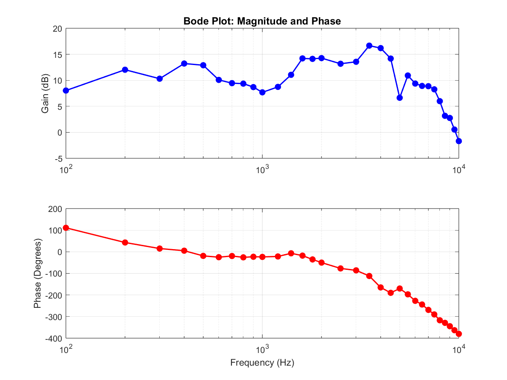
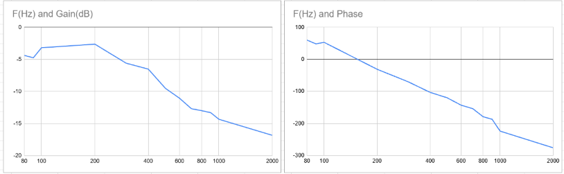
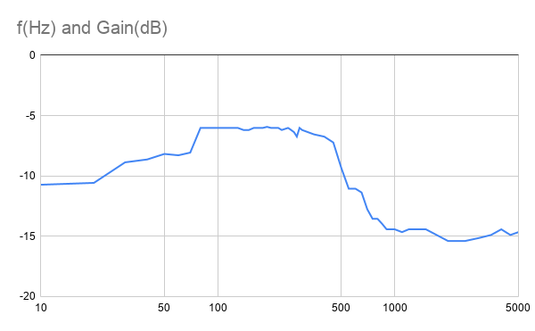
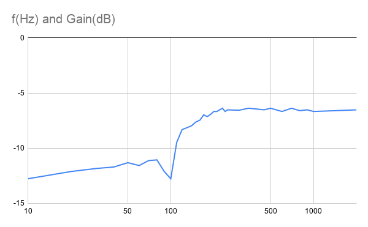

# Active Noise Cancellation in Headphones

**Control:** Analog feedback and lag compensation · **Analysis:** Experimental frequency response and stability · **Target:** 20 dB attenuation at 100 Hz

## Objective

Design and evaluate an analog feedback system for headphone noise cancellation, targeting 20 dB attenuation at 100 Hz while maintaining closed-loop stability and preserving the message signal.

The work includes plant magnitude/phase measurement, amplifier and lag-compensator design, open-loop stability evaluation, and closed-loop message/noise measurements at 100, 500, and 1000 Hz.

## Hardware and measurement equipment

- Headphone and acoustic feedback setup
- Function generator
- Digital storage oscilloscope (DSO) and probes
- Amplifier ICs and analog components
- Breadboard, wires, jumpers, and power supply

## System model

The measured plant $G(s)$ includes the headphone speaker, acoustic cavity, microphone, and microphone preamplifier. With compensator $C(s)$,

$$
L(s)=C(s)G(s).
$$

For unity negative feedback,

$$
T_{\mathrm{msg}}(s)=\frac{L(s)}{1+L(s)},
\qquad
T_{\mathrm{noise}}(s)=\frac{1}{1+L(s)}.
$$

The 20 dB attenuation target at 100 Hz is

$$
20\log_{10}\left|T_{\mathrm{noise}}(j2\pi\cdot100)\right|
\leq -20\ \mathrm{dB}.
$$

A lag compensator was considered to increase low-frequency loop gain while reducing gain at higher frequencies. The amplifier and compensator were evaluated together with the measured plant; increasing gain alone is insufficient if it compromises stability.

## Analog controller architecture

## Plant frequency-response measurement

A sinusoidal sweep was applied to the headphone setup. Input/output amplitudes and phase differences were measured using a digital storage oscilloscope. Gain was calculated as

$$
G_{\mathrm{dB}}=
20\log_{10}\left(\frac{V_{\mathrm{out}}}{V_{\mathrm{in}}}\right).
$$

The plant was measured at 31 frequency points from 100 Hz to 10 kHz. At 100 Hz, the measured gain was 8.03 dB and phase was $111^\circ$. Across the measurement range, gain varied from approximately $-1.69$ dB to $16.66$ dB.

### Measured plant Bode response from the report

## Cascaded open-loop response and stability

The measured cascaded open-loop magnitude remained below 0 dB across the measured 80–2000 Hz range. Phase crossed approximately $-180^\circ$ near 800–900 Hz, where magnitude was about $-13$ dB, corresponding to an approximate 13 dB gain margin.

The report notes that DSO measurements below 80 Hz were not accurate enough to directly observe the unity-gain crossover. The phase margin was therefore estimated from the measured trend, rather than measured at a reliable crossover frequency.

### Measured cascaded open-loop Bode response from the report

## Closed-loop message and noise response

| Frequency | Message $V_{\mathrm{out}}/V_{\mathrm{in}}$ | $T_{\mathrm{msg}}$ | Noise $V_{\mathrm{out}}/V_{\mathrm{in}}$ | $T_{\mathrm{noise}}$ |
|:---|---:|---:|---:|---:|
| 100 Hz | 0.500 | −6.02 dB | 0.230 | −12.77 dB |
| 500 Hz | 0.340 | −9.37 dB | 0.480 | −6.38 dB |
| 1000 Hz | 0.190 | −14.42 dB | 0.464 | −6.67 dB |

### Message response, $y/r$

### Output-noise response, $y/n$

The measured 100 Hz noise response was $-12.77$ dB, approximately 7.23 dB short of the $-20$ dB target. The results at 500 Hz and 1000 Hz also show less attenuation than at 100 Hz.

## Files

- [`matlab/freq_response.m`](matlab/freq_response.m) — frequency-response analysis script
- [`matlab/TF_Identifier.m`](matlab/TF_Identifier.m) — transfer-function identification script
- [`data/Exp4.xlsx`](data/Exp4.xlsx) — measurement workbook
- [`results/Freq_response.png`](results/Freq_response.png) — supplied plant Bode plot
- [`results/OL-Cascaded.png`](results/OL-Cascaded.png) — supplied cascaded open-loop plot
- [`results/y-r.png`](results/y-r.png) — supplied message response
- [`results/y-n.png`](results/y-n.png) — supplied noise response

## Takeaway

This experiment links measured plant dynamics to analog feedback design. It demonstrates frequency-response measurement, transfer-function analysis, compensator design, and stability evaluation. The measured 100 Hz attenuation did not reach the 20 dB target, so the remaining performance gap is an important part of the result.
